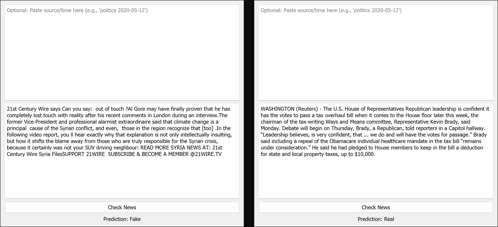
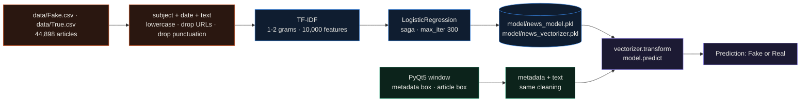
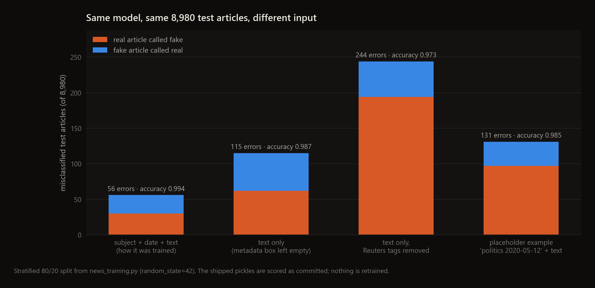
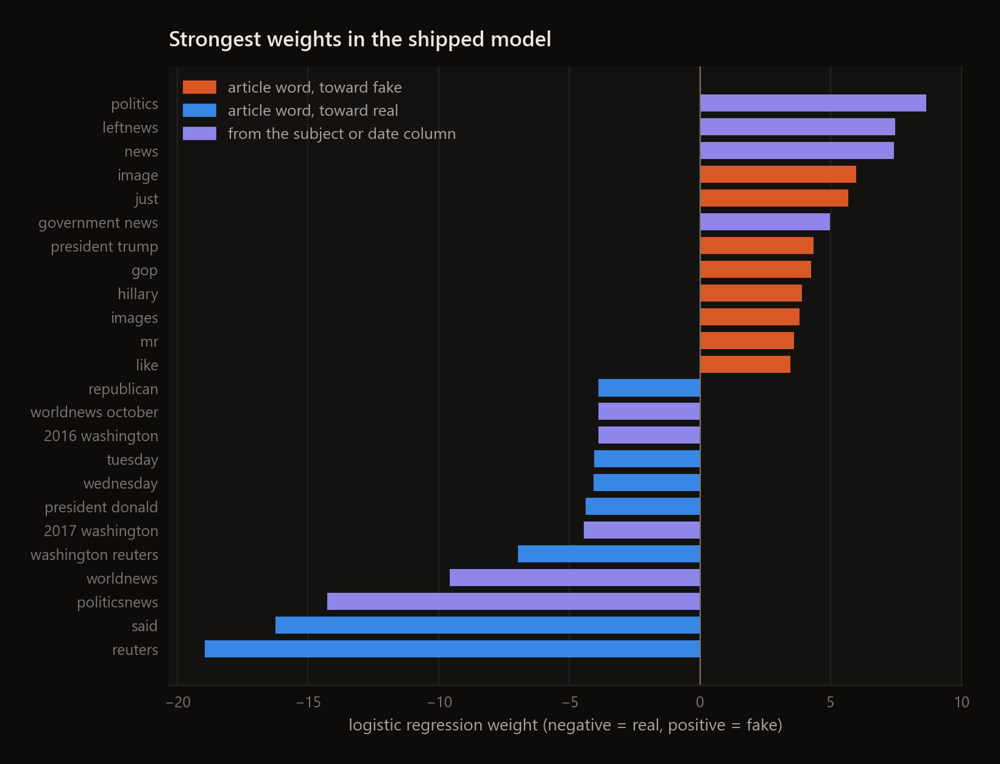

<div align="center">

# News Detector App

**A desktop fake-news checker: paste an article into a PyQt5 window and a pickled TF-IDF and logistic regression model labels it Fake or Real.**




</div>

This is the desktop version of [Fake-News-Detection](https://github.com/EllE961/Fake-News-Detection): the same
cleaning, TF-IDF settings and logistic regression, retrained with each article's subject and date in front of the
text, pickled, and loaded by a small PyQt5 window. Fake-News-Detection is the analysis version, trained on article
text only, where I compare models and measure how much the Reuters byline is worth.

Both articles in the screenshot come from the held-out 20% of the dataset. They were rendered with
`scripts/screenshot.py`, which drives the real window and calls the same slot as the Check News button.

## Highlights

- The shipped model scores 0.994 on 8,980 held-out articles (56 errors). Running `news_training.py` again reproduces `model/news_model.pkl` byte for byte.
- Adding subject and date cuts the errors on the same split from 91 (the text-only model in Fake-News-Detection) to 56. Real articles only use the subjects `politicsNews` and `worldnews`, fake ones use six other names, so "politicsnews" and "worldnews" are two of the four strongest real-side weights and "politics", "leftnews" and "news" are the three strongest fake-side ones.
- With the metadata box left empty, which is how most people will use it, accuracy is 0.987 (115 errors).
- Typing the box's own placeholder example, `politics 2020-05-12`, raises the number of real articles called fake from 62 to 97, because `politics` is a subject only fake articles carry.
- Removing the `(Reuters)` dateline from the test articles drops accuracy to 0.973, and 194 real articles come out as fake.

---

## How it works



`news_training.py` joins `subject`, `date` and `text` into one string per article, cleans it, makes the stratified
80/20 split, fits the vectorizer and the model on the training part, prints the test accuracy and pickles both into
`model/`. `main.py` opens `NewsClassifierApp` from `news_classifier_app.py`, which loads the two pickles once. On
Check News it joins the metadata box and the article box, runs the same `clean_text`, and shows the predicted label.

## Results

All numbers below come from the committed pickles, scored on the exact test split `news_training.py` uses. Nothing
is retrained; only the text handed to the model changes.



| input sent to the model | accuracy | real called fake | fake called real |
|---|---|---|---|
| subject + date + text, as in training | **0.994** | 30 | 26 |
| text only (metadata box empty) | 0.987 | 62 | 53 |
| text only, Reuters dateline and mentions removed | 0.973 | 194 | 50 |
| `politics 2020-05-12` in the metadata box + text | 0.985 | 97 | 34 |



Purple bars are tokens that come from the subject or date columns rather than the article: the subject names
themselves and bigrams such as "worldnews october" or "2017 washington", where the date runs into the dateline.
They separate the classes well here because the dataset's two sources file their articles under different
categories. They carry no information about an article pasted from anywhere else.

## Quickstart

```bash
git clone https://github.com/EllE961/news-detector-app.git    # about 240 MB: data/ and model/ are committed
cd news-detector-app
pip install -r requirements.txt

python main.py                    # opens the window with the committed model
python news_training.py           # optional: retrains and overwrites model/ (about 1.5 min, prints 0.9937...)
python scripts/make_figures.py    # every number and figure in this README (about 1.5 min)
python scripts/screenshot.py      # re-renders docs/assets/hero.png
```

Run everything from the repo root; the app and the training script use relative paths to `model/` and `data/`.

## Repository map

```text
main.py                   entry point: creates the QApplication and the window
news_classifier_app.py    NewsClassifierApp: loads the pickles, two text boxes, Check News button, result label
news_training.py          builds subject + date + text, trains TF-IDF + logistic regression, pickles both
model/                    news_model.pkl (81 KB) and news_vectorizer.pkl (63 MB)
data/                     Fake.csv and True.csv from the Kaggle Fake and Real News dataset (116 MB)
scripts/make_figures.py   scores the committed model on the test split under different inputs
scripts/screenshot.py     renders the real window off screen and saves the hero image
docs/assets/              figures and screenshots used in this README
```

## Limitations

- Real in this dataset means Reuters wire copy from 2016 and 2017, and fake means articles from sites flagged by PolitiFact and Wikipedia. The model learns those sources' styles and categories, not whether a claim is true, so its verdict on an article from any other outlet says little.
- The metadata box is labelled "source/time", but the model only knows this dataset's subject names. Text typed there only moves the prediction when it matches one of those names, and the placeholder's own example pushes toward Fake.
- The window shows a label only. The model has `predict_proba`, but the app doesn't show a confidence.
- `news_vectorizer.pkl` is 63 MB because scikit-learn keeps `stop_words_`, the 3,548,350 terms cut by `max_features`. `transform` never reads it; without it the pickle is 0.43 MB.
- The pickles were written with scikit-learn 1.2.2 and other versions warn or refuse to load them. Like any pickle they run code on load, so only use ones you trust.
- One train/test split and no tuning. The text-only comparison and ablation live in [Fake-News-Detection](https://github.com/EllE961/Fake-News-Detection).

Dataset: Ahmed, Traore and Saad, ISOT Fake News dataset (University of Victoria), via the Kaggle upload by Clément Bisaillon.

## License

MIT, see [LICENSE](LICENSE).
